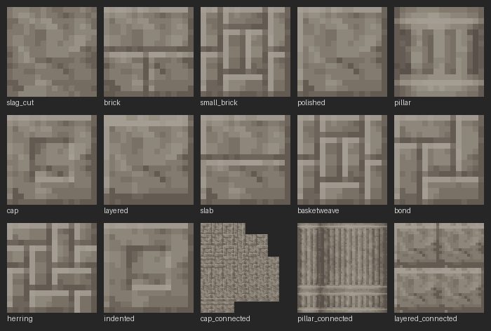

# Slag building stone series — preview for Create: Metallurgy

Proposal assets for [Create: Metallurgy](https://github.com/Lucreeper74/Create-Metallurgy), branch `mc1.21.1/dev`.

This repository only holds a preview so the texture set can be reviewed in a GitHub issue. It is not a resource pack release.

## What is this

15 block textures for a slag building stone series, derived from the Create 6.0.10 dripstone stone-type palette. Every source colour was remapped to the slag ramp taken from `createmetallurgy:slag_block`, with pixel layout, mortar lines, borders, resolution and alpha unchanged. No hand-drawn overlay was added.

The palette was sampled from the five tone steps of the vanilla dripstone blocks and matched against the corresponding pixels of the existing slag block, then interpolated. The four unreferenced slag textures already present in `assets/createmetallurgy/textures/block/palettes/stone_types/` (`cut_slag_block`, `cobbled_slag_block`, `slag_bricks`, `slag_tiny_bricks`) share the same average colour, so this set is visually consistent with them.

## Contents

| Folder | Files |
| --- | --- |
| `cut` | `slag_cut` |
| `brick` | `slag_cut_brick` |
| `small_brick` | `slag_cut_small_brick` |
| `polished` | `slag_cut_polished` |
| `pillar` | `slag_cut_pillar`, `slag_cut_pillar_connected` (64×64 atlas) |
| `cap` | `slag_cut_cap`, `slag_cut_cap_connected` (128×128 atlas) |
| `layered` | `slag_cut_layered`, `slag_cut_layered_connected` (32×32 atlas) |
| `slab` | `slag_cut_slab` |
| `alternatives` | `slag_cut_basketweave`, `slag_cut_bond`, `slag_cut_herring`, `slag_cut_indented` |

12 single-face 16×16 textures plus 3 connected-texture atlases.

## Preview

## Licence

Textures are recoloured derivatives of Create's dripstone stone-type textures. Create is MIT licensed, so redistribution and modification are permitted with attribution. The recolour work itself is released under MIT as well, to match Create: Metallurgy.

## 中文说明

本仓库仅用于在 issue 中展示这套炉渣建筑纹理，不是资源包发布页。纹理以 Create 6.0.10 滴水石系列为底稿改色，配色对齐 `createmetallurgy:slag_block`，像素排列、砖缝、边框、尺寸与透明度均未改动。
